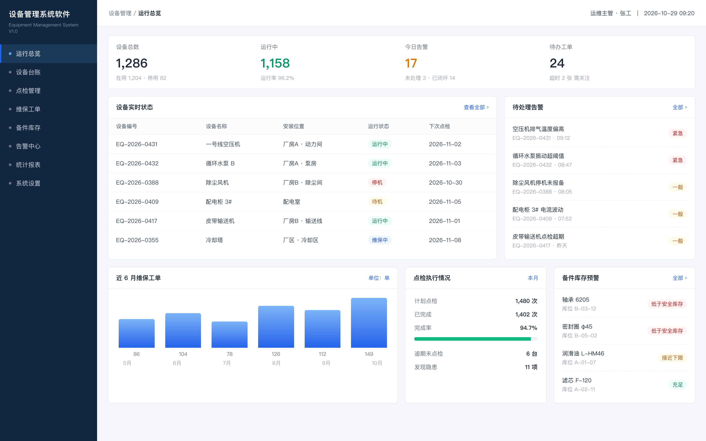

# dsh-copyright-kit · 软著工坊

把「一个代码仓库 + 一个软件名」变成软件著作权登记要交的材料。DeepSeek Harness 插件。



> 为什么要它：软著材料里最费时间的不是写内容，是**排版合规**——源程序前后各 30 页、每页不少于 50 行、页眉要软件名+版本号、右上角要页码。这些规则是死的，但每次都要手工折腾一遍。

## 安装

**从 GitHub 装（推荐）**

```bash
dsh plugin --profile web add github:Lucky020/dsh-copyright-kit
```

**本地开发（link 安装，改代码立刻生效，不用重新发版）**

```bash
dsh plugin --profile web add link:/absolute/path/to/dsh-copyright-kit
```

装完重启 `dsh web` —— server 端工具要重启才会注册。

> 两种不要同时装：会重复注册同名工具，报 `already registered`。

依赖：

| 用途 | 依赖 |
|---|---|
| 源程序文档 / 说明书 | `python3` + `python-docx` |
| 界面截图 | Google Chrome（或 Chromium / Edge）；也可用 `DSH_COPYRIGHT_CHROME` 指定可执行文件 |

```bash
python3 -m pip install python-docx
```

## 六个工具

### `copyright_source_doc` — 源程序鉴别材料

```json
{
  "root": "/Users/you/project/donghuan",
  "software_name": "设备管理系统软件",
  "version": "V1.0",
  "out_path": "/Users/you/软著/设备管理系统软件_V1.0_源程序.docx",
  "exclude": ["tests", "migrations"]
}
```

- 递归收集源码（自动跳过 `node_modules`、`.venv`、`dist`、二进制、锁文件、隐藏文件）
- 少于 60 页 → 全量提交；否则取**前 30 页 + 后 30 页**
- 每页固定 50 行，显式分页符，行距固定 → 分页与 Word/WPS 渲染无关，可复现
- 页眉：`软件名  V1.0`，右上角 `PAGE` 域自动页码
- 输出结构化结果：页数、收录文件数、总行数、提交行数

### `copyright_manual` — 软件说明书排版

先把内容写成一个 JSON spec：

```json
{
  "software_name": "设备管理系统软件",
  "version": "V1.0",
  "toc": true,
  "sections": [
    { "heading": "引言", "level": 1, "paragraphs": ["本文档说明……"] },
    { "heading": "系统概述", "level": 2, "paragraphs": ["面向运维人员……"], "bullets": ["设备台账", "巡检计划"] },
    { "heading": "功能模块", "level": 2,
      "table": { "header": ["模块", "说明"], "rows": [["台账", "设备基础信息"]] } },
    { "heading": "系统首页", "level": 2, "paragraphs": ["……"], "image": "/abs/shot.png", "caption": "图 1  系统首页" }
  ]
}
```

```json
{ "spec_path": "/abs/spec.json", "out_path": "/abs/说明书.docx" }
```

- 支持 `paragraphs` / `bullets` / `steps`（编号步骤）/ `table` / `image` 五类内容
- 标题自动编号（1 / 1.1 / 1.1.1），一级黑体三号、二级黑体四号
- 正文宋体小四、1.5 倍行距（每页 ≥30 行），首行缩进 2 字符
- 图片居中、限宽 14cm、图注居中；表格套用 Table Grid
- 页眉软件名+版本号、右上角页码
- `toc: true` 插入目录域（Word 打开后右键 → 更新域）

### `copyright_screens` — 五屏界面截图

按一份 spec 渲染**同一套壳**下的多张页面，headless Chrome 出 2 倍高清 PNG（默认 3200×2000）。

```json
{
  "software_name": "设备管理系统软件",
  "version": "V1.0",
  "subtitle": "Equipment Management System V1.0",
  "user": "运维主管 · 张工",
  "time": "2026-10-29 09:20",
  "nav": ["运行总览", "设备台账", "点检管理", "维保工单", "统计报表"],
  "screens": [
    { "id": "01-总览", "title": "运行总览", "active": "运行总览",
      "blocks": [
        { "type": "kpis", "items": [{ "label": "设备总数", "value": "1,286", "sub": "在用 1,204" }] },
        { "type": "table", "title": "设备实时状态", "span": 8, "toneColumns": [3],
          "columns": ["设备编号", "名称", "状态"],
          "rows": [["EQ-2026-0431", "一号线空压机", "运行中"]] },
        { "type": "list", "title": "待处理告警", "span": 4,
          "items": [{ "title": "温度偏高", "sub": "EQ-2026-0431", "tag": "紧急" }] }
      ] }
  ]
}
```

内容块（`span` 是 12 栅格里的列宽，默认见括号）：

| 类型 | 说明 | 默认 span |
|---|---|---|
| `kpis` | 顶部指标卡，4 列 | 12 |
| `table` | 数据表；`toneColumns` 指定哪几列按文案自动打状态标签 | 8 |
| `list` | 右侧列表（标题 + 副标题 + 标签） | 4 |
| `chart` | 柱状图（`bars`），`unit`/`max` 可选 | 6 |
| `progress` | 指标 + 进度条（`metrics` / `bar` / `after`） | 4 |
| `form` | 双列字段卡（详情页） | 6 |
| `timeline` | 流程时间轴（`state`: `done` / `active`） | 4 |

状态标签按文案自动配色：`紧急|停机|故障|超期|低于安全库存` → 红，`一般|待机|逾期` → 黄，`维保中|处理中` → 蓝，`正常|运行中|已完成|充足` → 绿。

**排版经验**：每屏放 **3 行**内容块（KPI 行 + 两个内容行）刚好填满 1600×1000；只有 2 行会在底部留大片空白。内容少的页面可以在 spec 里把 `height` 调到 820。

### `copyright_apply_info` — 申请表填报信息

```json
{
  "root": "/Users/you/project/donghuan",
  "software_name": "设备管理系统软件",
  "version": "V1.0",
  "spec_path": "/abs/spec.json",
  "developer": "某某科技有限公司",
  "out_path": "/abs/申请表信息.md"
}
```

能算的都算，算不出来的标 ⚠：

| 字段 | 来源 |
|---|---|
| 源程序量 / 源码文件数 / 编程语言 | 扫描仓库（跳过依赖、构建产物、二进制） |
| 开发框架 / 数据库 | 解析 `requirements.txt`、`package.json`、`pom.xml`、`go.mod`、`Dockerfile` 等 |
| 开发完成日期 | git 最后一次提交日期 |
| 面向领域 / 功能模块 | 说明书 spec 的章节 + 名称关键词 |
| 功能简介（≤300 字）/ 技术特点 | spec 里写了 `summary` / `tech_points` 就用它；否则按模块名与依赖栈拼草稿 |

输出一份 Markdown 填报单，字段可逐项复制进软著在线申请表。框架与数据库识别按**词边界**匹配，不会把 `login` 认成 Go 的 Gin。

### `copyright_pack` — 批量出件

一份 manifest，多个软件各出一套：

```json
{
  "out_dir": "/abs/软著材料",
  "defaults": { "version": "V1.0", "developer": "某某公司" },
  "software": [
    { "name": "设备管理系统软件", "root": "/abs/donghuan",
      "exclude": ["frontend", "docker"],
      "spec": "/abs/device/spec.json",
      "screens": "/abs/device/screens.json" },
    { "name": "智慧热网系统软件", "root": "/abs/religuanxian-frontend",
      "spec": "/abs/heating/spec.json",
      "screens": "/abs/heating/screens.json" }
  ]
}
```

每个软件输出一个目录：

```
<out_dir>/<软件名>/
├── <软件名>_V1.0_源程序.docx
├── <软件名>_V1.0_说明书.docx
├── <软件名>_申请表信息.md
└── screens/*.png
```

说明书里**没写 `image` 的章节，会按「章节标题 === 截图标题」自动挂图**，不用手工填路径（`injected` 会告诉你挂了几张）。单件失败不影响其它件，最后给出成功/失败清单。

实测两个系统（设备管理 + 智能热网）批量跑完 **46 秒**。

### `copyright_kit_status` — 环境自检

生成失败时先跑它：检查 python3、python-docx、两个脚本是否存在。

## 发布到 npm（维护者）

> 注意：本机 `~/.npmrc` 里是 `registry.npm.taobao.org`（已废弃的镜像），登录和发布都要显式指定官方源。

```bash
npm login --registry=https://registry.npmjs.org/
npm publish --registry=https://registry.npmjs.org/
```

npm 默认要求 2FA，发布会索要一次性验证码；也可以用带 Publish 权限的 Granular Token 免 OTP。

发布前自查：

```bash
npm pack --dry-run     # 只应包含 lib/、cordis.patch.yml、README、CHANGELOG、LICENSE
```

## 写作纪律（重要）

**能从代码里数出来的，工具自己算；数不出来的，先问，不要先写。**

| 类型 | 处理方式 |
|---|---|
| 接口、表名、字段、目录、行数、git 日期 | 工具自动导出，禁止手写 |
| 模块名、菜单叫法 | 从路由前缀 / 菜单表 / 页面目录抽，抽不到就问 |
| 功能描述、操作步骤、业务规则 | **代码里没有的，一律先问用户**，不许按"常规业务"推断后混进正文 |
| 甲方名称、完成日期、发表状态 | 只有用户知道，先问 |

**用户提供的事实（软件全称、版本号、著作权人、日期、模块叫法）一律原样使用，不缩写、不润色、不改写。**
软件简称、首次发表日期这类只有用户能定的字段，没给就填「待填写」，系统绝不自动推导。

反例（不要这样做）：先把 4,000 字写完，再让用户"逐项核对"——用户要花半小时分辨哪句是真的，而且分不清。
正例：开写前一次性问清 6–8 个问题，收到回答后一次成稿。

项目目录结构、模块划分、字段叫法与常见形态不同的，**先问再写**；不要按"通用项目长这样"去套。

### 页码位置

规范写法是**页眉右上角**（中国版权保护中心：页眉标注软件名称与版本号，右上角标注页码），默认即此。

需要页脚居中时，在 spec 里写 `"page_number": "bottom"`，或给 `copyright_source_doc` / `copyright_manual` 传 `--page-number bottom`。

## 篇幅配方（目标 25–30 页）

说明书页数几乎完全由内容密度决定。实测**每页约 1,000 字**，或 **1 张截图 ≈ 0.5 页**，或 **1 行表格 ≈ 1.6 行正文**。8 页的文档，通常只写了 2,000 字。

工具会返回 `est_pages`（估算页数）和 `thin`（< 20 页）标记。要稳定到 25 页以上，按这个配方写 spec：

| 内容 | 数量 | 贡献页数 |
|---|---|---|
| 前置章节（引言 / 概述 / 运行环境 / 权限 / 部署 / FAQ） | 8 章、约 2,000 字 | 4–5 页 |
| 功能模块 | 6–8 个 | — |
| 每模块：功能描述 + 界面说明 | 300–400 字 | 0.4 页 |
| 每模块：主要字段表 | 5–10 行 | 0.3 页 |
| 每模块：操作步骤 | 4–6 条 | 0.2 页 |
| 界面截图 | 5–8 张 | 2.5–4 页 |
| 代码附录（接口清单 / 数据表 / 目录结构） | 自动生成 | 3–6 页 |

`copyright_manual` 传 `appendix_root`（或 `copyright_pack` 的每项默认开启），会自动从代码里抽出**接口清单、数据表清单、源代码组织**三张附录表——这部分不是编的，是从路由与模型定义里数出来的，页数还最实在。

> `est_pages` 是按 Word 排版密度估算的，误差约 ±10%，最终页数以 Word / WPS 打开为准。

## 已知边界

- 右上角页码用的是 Word 右对齐制表位；macOS Quick Look 既**不认自定义制表位、也不分页**，所以在 Finder 预览里页码会挤在标题后面、目录与正文连成一片。Word / WPS 打开正常，不影响提交。
- 源程序文档的 60 页是**构造出来的**：每页 50 段、行距固定 11.5pt（50 × 11.5 = 575pt，小于可用 728pt），每页首段带「段前分页」。所以页数与每页行数不依赖渲染器。
- 说明书分页随内容流动，不保证每页恰好 30 行（1.5 倍行距下约 32 行）。
- 截图里的数据是**示例数据**，提交前请按真实项目改一遍字段与数值——软著审查看的是界面与功能是否真实对应，不是数字好不好看。
- `copyright_apply_info` 的 `exclude` 要与 `copyright_source_doc` 一致，否则「源程序量」会和实际提交的源程序文档对不上。\n- 截图按 1600×1000 固定视口渲染，比这更宽的表格会被压窄；表格列多时拆成两屏更稳。
- 源程序按文件路径排序抽取；如需特定顺序，先用 `exclude` 收窄范围。

## 路线

- **P0（已完成）** 源程序文档 + 说明书排版
- **P1（已完成）** 五屏界面截图：一套壳 + 7 种内容块 → headless Chrome 出 2 倍 PNG，路径直接喂给 `copyright_manual`
- **P2（已完成）** 申请表字段推导：源程序量、语言、框架、数据库、完成日期、功能模块、300 字简介草稿
- **P3（已完成）** 批量出件 `copyright_pack`：一份 manifest 跑多个软件，说明书按标题自动挂图

## 许可

MIT
